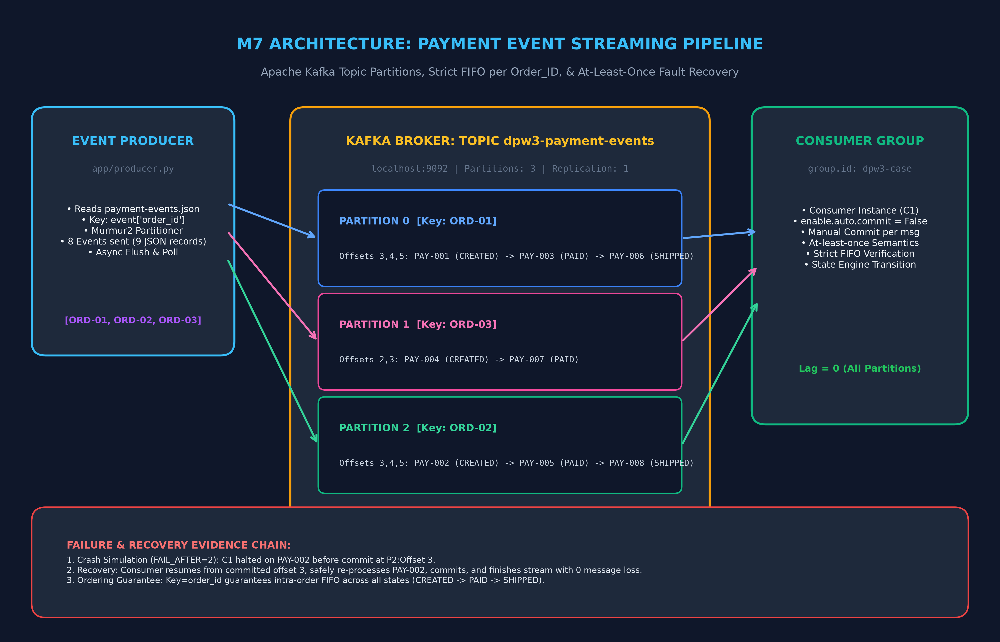

# Data Processing Workflow — Modul 3 (M7)
## Event-Driven & Streaming Architecture with Apache Kafka

**Mata Kuliah:** Praktikum Data Processing Workflow (Semester 5)  
**Program Studi:** D4 Sains Data Terapan, Departemen Teknik Informatika dan Komputer  
**Institusi:** Politeknik Elektronika Negeri Surabaya (PENS)  
**Mahasiswa:** Udi Adhahaska Arta Ananta  
**NRP:** 3324600052  

---

## 📌 Deskripsi Repositori
Repositori ini berisi seluruh artefak, kode sumber, konfigurasi Docker, dan laporan resmi pengerjaan **Modul 3 (M7): Data Ingestion – Event-Driven & Streaming Architecture**.

Pengerjaan terbagi menjadi dua bagian:
1. **Eksperimen Terpandu (Bab 3):** Mempelajari dan membuktikan arsitektur Apache Kafka, topic, partisi, consumer group rebalance, committed offset tracking, injeksi kegagalan worker, dan komparasi semantik *At-least-once* vs *Exactly-once*.
2. **Tantangan Mandiri (Bab 4):** Membangun pipeline *Payment Event Stream* dengan jaminan urutan ketat (*strict intra-order FIFO*) per `order_id`, paralelisasi antar order, dan toleransi kegagalan tanpa kehilangan pesan (*zero message loss*).

---

## 🏗️ Arsitektur Pipeline (Payment Event Stream)



### Keputusan Rekayasa Arsitektur:
* **Topic & Partitioning:** Topic `dpw3-payment-events` dengan 3 partisi independen untuk load balancing dan paralelisasi order.
* **Key Hashing Strategy:** `key = event["order_id"]`. Hashing Murmur2 Kafka menjamin semua event dari order yang sama (CREATED -> PAID -> SHIPPED) deterministik dialirkan ke partisi yang identik secara FIFO.
* **Consumer Group:** `dpw3-case` mengkoordinasikan konsumsi asinkron dan failover rebalancing.
* **Commit Strategy & Delivery Semantics:** `enable.auto.commit = False` dengan synchronous commit manual per record setelah proses tuntas, menjamin semantik **At-least-once** (*zero loss fault tolerance*).

---

## 📊 Hasil Komparasi Semantik Pengiriman Pesan (Bab 3.8)

| Parameter Evaluasi | At-least-once | Exactly-once | Keterangan Rekayasa |
|---|:---:|:---:|---|
| **Input Events** | 10 | 10 | Jumlah event masukan yang diuji |
| **Total Output Records** | **10** | **10** | Pada At-least-once terjadi pemrosesan ulang pesan uncommitted |
| **Unique `event_id`** | 8 | 10 | Seluruh data unik tetap utuh |
| **Duplicate Records** | **2** | **0** | Duplikasi muncul saat crash pasca-produce pra-commit |
| **Status Transaksi** | Non-atomic | Atomic Read Committed | Transaksi Kafka mengabaikan record uncommitted |

---

## 📂 Struktur Direktori

```text
M7/
├── 52_Udi Adhahaska Arta Ananta_Resmi.docx      # Laporan resmi Word (dilengkapi screenshot aktual)
├── 52_Udi Adhahaska Arta Ananta_Resmi.pdf       # Laporan resmi format PDF siap baca
├── README.md                                    # Dokumentasi repositori GitHub
├── .gitignore                                   # File pengabaian cache & file temporary
│
├── materi/                                      # Panduan modul & artefak asli dari dosen
│   ├── Modul 3.pdf
│   └── Modul_Praktikum_Event_Driven_Streaming_Kafka.md
│
└── pengerjaan/                                  # Source code pengerjaan
    ├── m7_kafka_streaming_walkthrough.ipynb     # Jupyter Notebook interaktif pra-render
    │
    ├── 1_eksperimen_lab/                        # Bab 3: Eksperimen Terpandu
    │   ├── docker-compose.yml                   # Service broker Kafka 4.2.1
    │   ├── app/                                 # Script producer, consumer, transformer, inspector
    │   └── evidence/                            # 9 Gambar bukti terminal (E01 s/d E09)
    │
    └── 2_tugas_mandiri/                         # Bab 4: Tantangan Mandiri
        ├── student-starter/                     # Pipeline producer & consumer pembayaran
        └── submission/                          # Berkas submisi resmi
            ├── architecture.puml                # Source PlantUML
            ├── architecture.png                 # Gambar diagram resolusi tinggi
            ├── technical-analysis.md            # Laporan analisis teknis keputusan arsitektur
            ├── changed-files/                   # Kode producer.py & consumer.py
            └── evidence/                        # Bukti E01, E02, dan E03
```

---

## 🚀 Panduan Menjalankan Secara Lokal

### 1. Menjalankan Kafka Broker
```bash
cd pengerjaan/1_eksperimen_lab
docker compose up -d
```

### 2. Menjalankan Payment Pipeline (Tantangan Mandiri)
```bash
cd ../2_tugas_mandiri/student-starter

# Mengirim event pembayaran
python app/producer.py

# Memproses event secara FIFO
python app/consumer.py
```

### 3. Simulasi Crash & Recovery
```powershell
# Simulasi crash saat event ke-2 sebelum commit
$env:FAIL_AFTER=2; python app/consumer.py

# Menjalankan consumer recovery (melanjutkan dari uncommitted offset)
$env:FAIL_AFTER=0; python app/consumer.py
```
